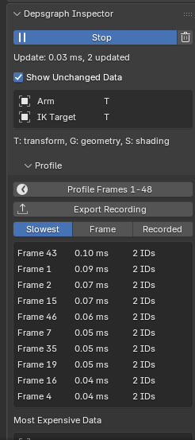
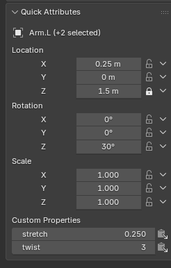
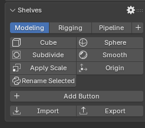
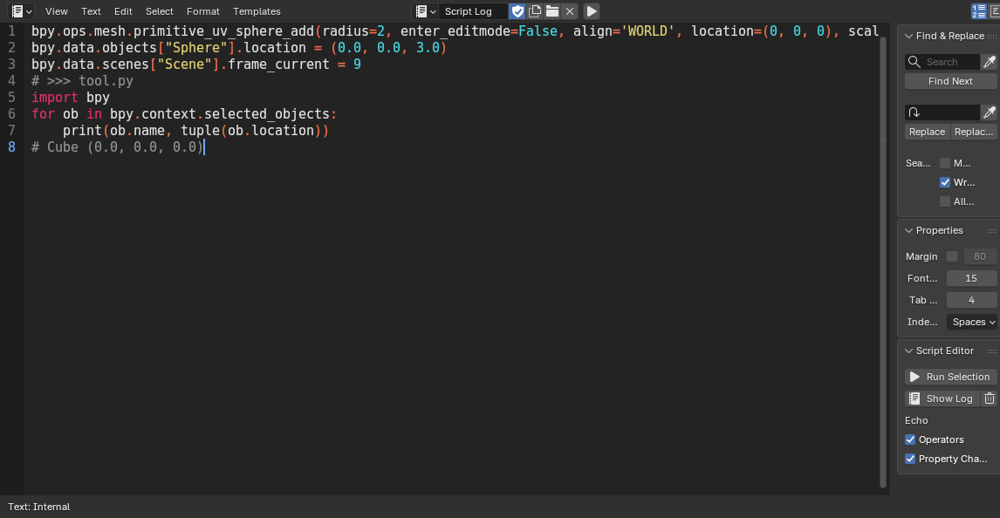
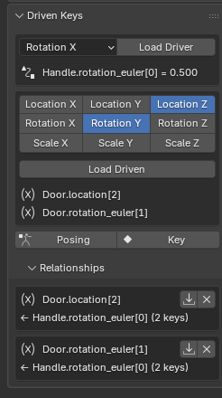

# Blender Workbench Plus

[](https://github.com/aeflorezm/blender-workbench-plus/actions/workflows/tests.yml)

Herramientas de flujo de trabajo y pipeline para Blender, hechas con el mismo nivel de exigencia que Blender.

*[Read in English](README.md)*

> **Estado:** desarrollo temprano, para Blender 5.2 LTS. Los comentarios son bienvenidos en los issues.

## Instalación

1. Descarga `workbench_plus-<versión>.zip` de los [Releases](https://github.com/aeflorezm/blender-workbench-plus/releases)
   (o constrúyelo, ver *Desarrollo*).
2. En Blender: *Edit → Preferences → Get Extensions → ⌄ → Install from Disk* y elige el zip.
3. Los paneles están en el sidebar del 3D Viewport (N), pestaña *Workbench*. Cada herramienta se puede
   desactivar en *Preferences → Add-ons → Workbench Plus*.

## Herramientas

- **Command Server:** servidor de control remoto dentro de Blender (JSON-RPC en localhost, token, errores
  estructurados, lotes, notificaciones) para IDEs, pipelines y agentes de IA.
- **Depsgraph Inspector:** qué se re-evalúa, de qué depende el objeto activo y cuánto tarda cada frame;
  exporta trazas para Perfetto.
- **Quick Attributes:** edición rápida de canales en muchos objetos a la vez, con sliders virtuales.
- **Shelves:** barras de botones para tus scripts y operadores, que se pueden compartir.
- **Script Editor con eco:** el Python detrás de cada acción de la interfaz.
- **Driven Keys:** relaciones de drivers creadas posando, sin escribir expresiones.

La mayoría se instala como una **extensión** normal (funciona en Blender 5.2 LTS oficial). Lo que necesita
cambios en el núcleo vive en una rama aparte de Blender, y las mejoras de interés general se proponen a Blender.

## Command Server

Permite que otros programas controlen un Blender en ejecución: ejecutar Python, llamar operadores, leer y
escribir propiedades (también en lotes que se deshacen en un solo paso) y recibir eventos como cambios de frame
o carga de archivos.

- Se inicia en *Preferences → Add-ons → Workbench Plus → Command Server* (o con *Start Automatically*).
  Solo escucha en `127.0.0.1`.
- Sin interfaz: `blender -b --python-expr "import bpy; bpy.ops.wbp.command_server_serve()"` atiende peticiones
  hasta que un cliente envía `shutdown`.
- Los clientes leen el puerto y un token por sesión de `command_server.json`, en el directorio de usuario del add-on.

```python
from client import Client  # workbench_plus/command_server/client.py, un solo archivo sin dependencias.

with Client.from_discovery_file(ruta_a_command_server_json) as blender:
    blender.call("call_operator", operator="mesh.primitive_cube_add", properties={"location": [0, 0, 1]})
    print(blender.call("get_property", path="active_object.location", root="context"))
```

El protocolo (métodos, valores, códigos de error, eventos) está en [`docs/command_server.md`](docs/command_server.md)
(en inglés).

## Depsgraph Inspector

*3D Viewport → Sidebar → Workbench → Depsgraph Inspector*



- **Record** lista los data-blocks que actualizó cada evaluación, qué cambió (transform, geometría, shading) y
  cuánto tardó. Solo instala sus handlers mientras graba.
- **Relations** muestra los data-blocks que usa el objeto activo (parent, targets de constraints y modifiers,
  drivers, action...) y los que lo usan a él, con un botón para re-evaluar y cronometrar cualquiera.
- **Profile** recorre el rango de frames de la escena y lista los frames más lentos y los data-blocks
  actualizados en las evaluaciones más caras. *Export Recording* lo guarda en JSON o como traza de Chrome,
  que se abre en [Perfetto](https://ui.perfetto.dev).

Los tiempos son por evaluación: Python no tiene hooks dentro de la evaluación de cada objeto, así que el ranking
de data-blocks señala sospechosos en vez de repartir el tiempo entre ellos.
<br clear="right">

## Quick Attributes

*3D Viewport → Sidebar → Workbench → Quick Attributes*



- Muestra los canales de location, rotation y scale del objeto activo; editar un valor lo aplica a **todos los
  objetos seleccionados**. Los canales bloqueados no se tocan.
- **Haz clic en el nombre de un canal** (X, Y, Z) y mueve el ratón para desplazar ese canal en todos los
  seleccionados, cada uno conservando su valor; clic para confirmar, clic derecho o Esc para cancelar.
  Shift para cambios finos, Ctrl por pasos.
- El botón ▾ de cada canal inserta una clave o un breakdown, bloquea/desbloquea, o silencia/activa su animación,
  en todos los seleccionados.
- También se listan las custom properties numéricas del activo, con un botón para copiar cada una a la selección.
<br clear="right">

## Shelves

*3D Viewport → Sidebar → Workbench → Shelves*



- Pestañas de botones; cada botón ejecuta un **operador** (con propiedades en JSON) o un **script de Python**,
  con su icono y tooltip. El engranaje muestra los controles para renombrar, reordenar y quitar.
- En el Text Editor, *clic derecho → Add to Shelf* convierte el texto seleccionado (o todo el texto) en un botón.
- Las shelves se guardan en `shelves.json`, en el directorio de usuario del add-on, tras cada cambio.
  *Export* escribe la shelf visible (o todas) en un archivo que otros pueden *importar*; las shelves con un
  nombre que ya existe se renombran, o se reemplazan con la opción *Replace*.
<br clear="right">

## Script Editor

*Text Editor → Sidebar → Workbench → Script Editor*

- **Run Selection** (Ctrl Shift Enter) ejecuta las líneas seleccionadas, o todo el texto, en un espacio de nombres
  que se conserva entre ejecuciones (con `bpy`, `C` para el contexto y `D` para `bpy.data`). El código y su salida
  o traceback se escriben en el texto *Script Log*, que se puede editar y volver a ejecutar como cualquier texto.
- **Echo Operators** escribe en el log cada operador ejecutado desde la interfaz, como la llamada de Python que
  lo repite.
- **Echo Property Changes** escribe los cambios de location, rotation, scale y visibilidad de los objetos, y del
  frame actual, como asignaciones de Python.

El log es un texto normal, así que se guarda con el archivo; se vacía con el botón de la papelera.



## Driven Keys

*3D Viewport → Sidebar → Workbench → Driven Keys*



1. Elige el canal driver (p. ej. *Rotation X*) y *Load Driver*: usa el objeto activo, o el hueso activo en
   Pose Mode.
2. Elige los canales driven y *Load Driven*: usan los demás objetos (o huesos) seleccionados.
3. Activa *Posing*, posa el driver y los canales driven, y pulsa *Key*. Repite para cada pose y desactiva
   *Posing*: ahora el driver mueve los canales driven, interpolando entre las poses.

Cada canal driven recibe un driver normal de Blender cuya F-curve convierte valores del driver en valores
driven, así que también se puede afinar en el editor de Drivers. *Relationships* las lista, para volver a cargar
una y añadir claves, o quitarla.
<br clear="right">

## Desarrollo

Ver la sección *Development* del [README en inglés](README.md#development): tests (`python tools/test.py`),
empaquetado (`python tools/build_extension.py`) y CI.

## Licencia

GPL-2.0-or-later, igual que Blender. Ver [`LICENSE`](LICENSE).
